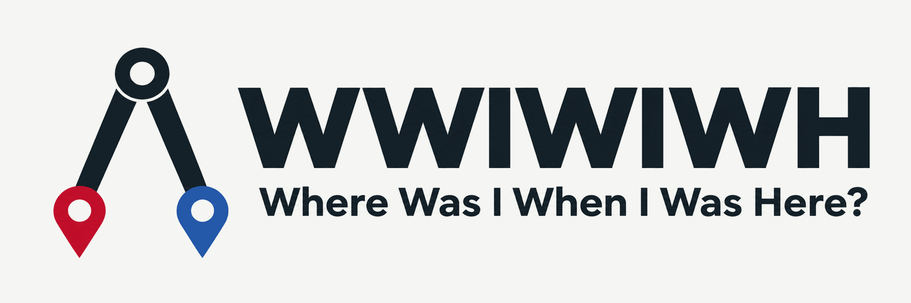
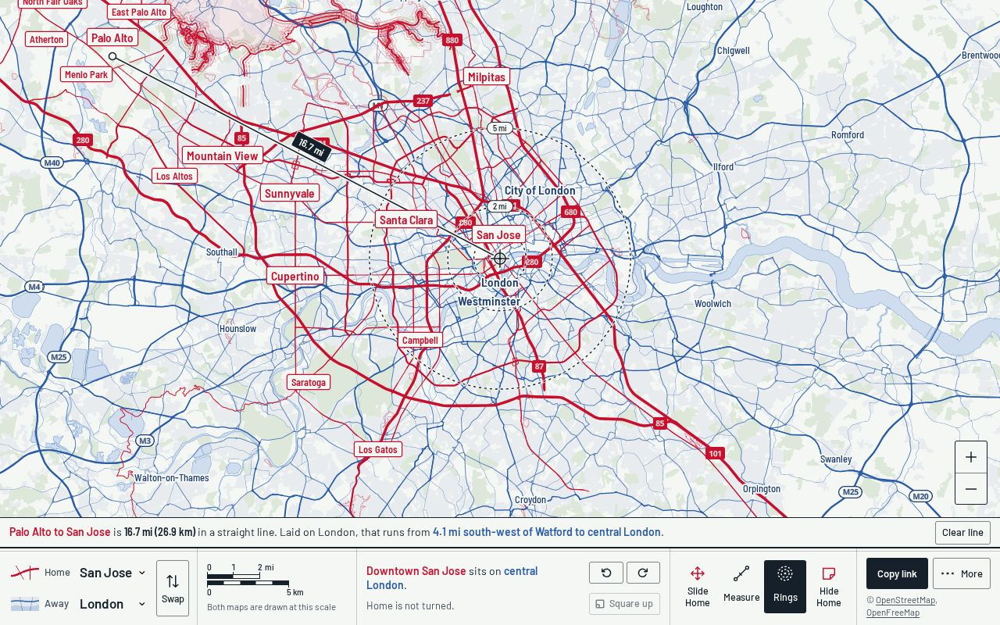

<h1>
  <picture>
    <source media="(prefers-color-scheme: dark)" srcset="assets/banner-dark.png">
    
  </picture>
</h1>

Lay the street map of a place you know over a place you don't, at the same scale.

**Open it at [wwiwiwh.com](https://wwiwiwh.com).** It runs in the browser. There is nothing to install and no account.

If you grew up somewhere, you carry its distances around with you. wwiwiwh draws that place, called Home, as red line-work on top of another place, called Away. Palo Alto to downtown San Jose is 16.7 miles. Put San Jose on central London and Palo Alto lands a few miles short of Watford.

## Using it

- **Pick two places.** The legend at the bottom left is also the pair of pickers. 171 metro areas are built in, and search finds any other city, town or neighbourhood.
- **Look around.** Drag, scroll and pinch move both maps together.
- **Slide Home.** Hold Shift and drag, or switch on Slide Home and drag. On a phone, Slide Home also gives you nudge buttons.
- **Turn Home.** Hold Alt and drag, right-drag, use the Turn buttons, or drag the knob on the ring around the pin. In slide mode a two-finger twist turns it.
- **The pin.** It marks the one spot where a Home position and an Away position are held together. Home turns about it, and the scale match is tightest there. Grabbing Home somewhere moves the pin to that spot, so you can drop one landmark on another and then turn Home until a second pair lines up. You can also drag the pin itself. When the pin ends up under your cursor without you going to it (after a slide, after picking a spot, on first load), it ignores presses until the cursor has moved away, so a drag from that spot pans both maps. The ends of a measured line behave the same way.
- **Set the pin by address.** Click the pin, press `A`, or pick "Set the pin by address" under More. Choose a Home spot and an Away spot by typing an address, a landmark or a neighbourhood. A Home spot is brought under the pin. An Away spot moves the pin there, with its Home spot. Both maps centre on the pin and zoom in to street scale. The two names in the pin sentence are buttons that open the same search, and recent spots are remembered on your device. Under More, "Recent places and spots" clears them or stops keeping them.
- **Measure.** Click two points to draw a line you know. The line belongs to Home and rides along when you slide or turn it. The caption says how long it is and where it runs on Away. "To an address" draws the line to an address on either place, from the pin or from a start you clicked.
- **Drive.** Click where a drive starts and where it ends, and it is drawn along the real roads with its distance and an estimated time. A drive is on one place: Home at first, and after that whichever place the last drive was on. Switch with "On Away" before placing the start. The other place then shades how far the same amount of time would get you from the spot the start lands on, or the same distance with "Same distance". Two rings go about the start, on both maps: a dashed one through the end, labelled with the distance between the two as the crow flies, and one of dashes and dots as far out as the drive is long by road. Slide or turn Home and the shading is worked out again from the new spot. "To an address" picks both ends by address, and "By road" on a measured line turns it into a drive between the same two ends.
- **Land and water.** Parks, woods, built-up areas and water are shaded for one place at a time: Away at first, with Home drawn over it as streets only. Under More, "Land and water from" (or `T`) gives them to Home instead. Home then lies underneath and Away is drawn over it as streets only.
- **Rings** draw round distances about the pin. **Hide Home** blinks the overlay off while you hold it, or latches on a quick tap. **Swap** exchanges the two places.
- **Copy link** gives an address that reopens the same view. The address bar updates as you go, so Back returns to the previous pair of places.
- **Colours.** More has seven sets of inks, each in a light and a dark version. Kingfisher (orange over blue) and Thistle (purple over green) keep Home and Away apart with red-green or blue-yellow colour blindness. Newsprint uses no colour at all. Stark is black and white, with every ink at 7:1 or better. Classic, Parchment and Blueprint are there for taste. The choice stays on your device.

Measure gives straight lines. Drive gives distances by road and times for a car without traffic, both estimates from OpenStreetMap data. There is one of the two on the map at a time.

## Keyboard

| Key | Does |
|---|---|
| Arrows | Move both maps |
| `+` `-` | Zoom |
| Shift + arrows | Slide Home (add Alt for small steps) |
| `[` `]` | Turn Home 5° (add Shift for 1°) |
| `0` | Square Home up |
| `S` | Slide Home on or off |
| `M` | Measure on or off. While measuring, Enter drops a line end at the centre |
| `D` | Drive on or off. While setting a drive, Enter drops an end at the centre |
| `G` | Rings on or off |
| `H` | Hide Home while held |
| `X` | Swap Home and Away |
| `P` | Put the pin at the centre of the view |
| `A` | Set the pin by address |
| `R` | Line up again |
| `U` | Miles or kilometres |
| `T` | Shade the land and water of Home or of Away |
| `1` `2` | Choose Home, choose Away |
| `C` | Copy link |
| `?` | Show the list of keys |
| Esc | Leave Slide Home, Measure or Drive |

The single-letter keys can be switched off under More.

## How accurate it is

A flat web map draws places far from the equator bigger than they are. London is drawn about 28% larger than San Jose at the same zoom. wwiwiwh undoes that, so a mile on Home is a mile on Away.

The match is exact at the pin and stays within about 1% across a city-sized view. It gets looser far from the pin, or zoomed out to a whole country, and the caption tells you when that happens. Between two very different latitudes the match at the pin can still be off by up to about half a percent, because the maths treats the Earth as a perfect sphere.

Drive times assume a car and no traffic.

## What leaves your browser

- Addresses you search for go to [Photon](https://photon.komoot.io), komoot's place search, to be looked up.
- The two ends of a drive, and the spot its start lands on in the other place, go to a public [Valhalla](https://valhalla.github.io/valhalla/) routing server run by [FOSSGIS](https://www.fossgis.de/) for OpenStreetMap.
- Map tiles come from [OpenFreeMap](https://openfreemap.org), which sees which parts of the world you look at.
- Recent places and spots, and your settings, are kept in your browser. Nothing is stored on a wwiwiwh server. The page has no accounts and no analytics. Cloudflare, which hosts the site, sees requests the way any web host does.

A link you copy carries the pin's position, any drive, and any names you gave their spots. A link made with your home address pinned contains that address, so check before you post one.

All three services are free and public, with no uptime promise. If tiles fail to load, wwiwiwh says so and keeps retrying. The routing server allows one request a second, so wwiwiwh asks it one thing at a time and remembers the answers. If a drive fails, wait a moment and press "Try again".

## Known limits

- Tested mostly in Chromium, with spot checks in Firefox and WebKit, Safari's engine. It hasn't been tried on a real phone, a Mac or with a screen reader yet.
- On a phone, a pin or line end that was just set pans the map when you drag it, until you touch the map somewhere else.
- Address search waits for three characters, so a two-character name finds nothing.
- A line end that sits exactly under the pin can't be grabbed with a pointer. Drag the other end, or draw the line again with Measure.
- A drive's ends can't be dragged. Set the drive again with Drive.
- The shaded reach only covers drives of up to 60 minutes (by time) or 100 km (by distance), and a drive longer than 1,500 km isn't worked out at all. Those are the routing server's limits.
- Subway and tram lines are missing below street zoom, because the tiles only carry them at zoom 14.
- A place name can sit on top of a route-number shield.

## Problems and ideas

Report a bug or suggest a change in [Issues](https://github.com/bsmccain/wwiwiwh/issues). Say which browser and device you used, and leave real addresses out of screenshots and links. Security and privacy problems go through [SECURITY.md](SECURITY.md) instead.

This is a personal project. Issues and pull requests are welcome, but they may not get a response.

## Running your own copy

wwiwiwh is a static site, so any static host can serve it. [SELF-HOSTING.md](SELF-HOSTING.md) covers building it, deploying it, which outside services it depends on and how to swap them, and how the code is laid out. [CONTRIBUTING.md](CONTRIBUTING.md) covers sending changes back.

## Credits and license

- Map data © [OpenStreetMap](https://www.openstreetmap.org/copyright) contributors.
- Vector tiles from [OpenFreeMap](https://openfreemap.org), in the [OpenMapTiles](https://openmaptiles.org) schema.
- Place search by [Photon](https://photon.komoot.io) from komoot.
- Driving routes and reach outlines by [Valhalla](https://valhalla.github.io/valhalla/), on the [FOSSGIS](https://www.fossgis.de/) server.
- Maps drawn with [MapLibre GL JS](https://maplibre.org).
- Typefaces Barlow and Barlow Semi Condensed, under the SIL Open Font License.

The code is MIT licensed. See [LICENSE](LICENSE).

---

Created in [T3 Code](https://t3.codes).
